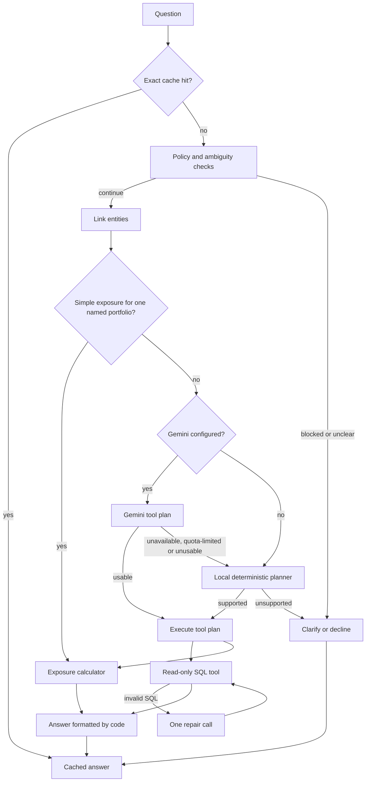

# Portfolio Analytics Agent

Ask questions about portfolio data in plain English. The agent writes and safely runs SQL, calculates sector exposures, or combines the two. It never lets the language model state a number: code formats every figure straight from the database.

This project was built for a take-home technical assessment for an AI/ML role at a financial-services firm. The brief asked for a SQL tool, a sector exposure calculator, a command-line agent and an evaluator. I extended it with a deterministic fallback planner, a Streamlit UI and a deployment. The commit history is kept as it happened.

**About the data.** The assessment's dataset, schema and ground-truth answers belong to the company that set the task, so they are **not published in this repository's current files**. The project runs on a fictional sample dataset in [sample_data/](sample_data/) with the same tables and the same data quirks; see [Data](#data). Everything else (the agent, tools, SQL guard, evaluator and tests) is original work.

Typical output (figures illustrative of the format):

```text
> Sector exposure of <portfolio name>
Sector exposure: <portfolio name>
sector        exposure_pct  portfolio_weight_pct  market_value_pct  holdings
<sector>      ...           ...                   ...               ...
Note: Recorded weights and market values disagree by up to N points; the recorded weights may be stale.
```

## At a glance

Public app: [portfolio-analytics-agent.onrender.com](https://portfolio-analytics-agent.onrender.com/). Source-code and Render health checks are documented separately in [the final evaluation report](reports/final_evaluation_results.md); the exact deployed commit has not been independently matched to this checkout.

- **Offline production fallback:** 10/10 exact on the official questions and 40/40 exact on the official plus extended set, with no Gemini client, cache, demo plans, or network attempts. See [the local fallback report](reports/local_fallback.md) and [the extended report](reports/local_fallback_extended.md). This is separate from live Gemini accuracy, and the extended set is not a blind test because planner intents were added after seeing its failures.
- **Latest recorded 40-question live Gemini run (8 November 2026):** 16/16 scored answers passed (15 exact, 1 equivalent); 24/40 attempts were infrastructure errors. This is not a complete live 40/40. See [the per-question report](reports/live_extended.md).
- **Speed:**
  - under 1 ms for repeat questions
  - about 10 ms for sector exposure, which skips the model
  - a median of 4.56 s when Gemini is needed, on the free tier
- **Every failure, cost and caveat** is in [docs/RESULTS.md](docs/RESULTS.md).

## Requirements checklist

| Assessment requirement | Where | How to check it |
| --- | --- | --- |
| SQL query tool | `run_sql` in [tools.py](portfolio_agent/tools.py), guarded by [sql_guard.py](portfolio_agent/sql_guard.py) | `python -m portfolio_agent --trace "How many portfolios do we have?"` prints the SQL and 13 |
| Exposure calculator, bonds excluded | `exposure_calculator` in [tools.py](portfolio_agent/tools.py) | `python -m portfolio_agent "Sector exposure of Balanced Portfolio"` shows the bonds excluded |
| Command-line agent that chooses a tool | [agent.py](portfolio_agent/agent.py) | `--trace` shows the tool chosen |
| Evaluator against the ground truth | [evaluate.py](evaluate.py), [evaluation.py](portfolio_agent/evaluation.py) | `python evaluate.py`, or `--self-test` without an API key |
| Brief documentation and a diagram | This page and [docs/](docs/) | Diagram below |
| Clean code with error handling | 312 tests, Ruff lint and formatting, CI on every push | `pytest` |

**Optional enhancements:**
- **SQL safety:** parameterised queries, validation before execution and graceful database errors.
- **Operations:** logging, input validation and caching.
- **Interfaces:** a Streamlit web UI, a REST API and concurrent requests.
- **Evaluation:** scoring that favours efficient queries, and hybrid questions that use both tools.
- **Metadata retrieval:** names in the question are matched to exact database values and added to the prompt. Retrieving parts of the schema was measured and rejected. See [docs/DESIGN.md](docs/DESIGN.md).

## Run it

Requires Python 3.12 or newer. Gemini is optional for the supported deterministic intents; set `GEMINI_API_KEY` for broader model-planned questions.

```bash
python -m venv .venv
source .venv/bin/activate          # Windows: .venv\Scripts\activate
pip install -r requirements-dev.txt
export GEMINI_API_KEY=your-key   # optional; PowerShell: $env:GEMINI_API_KEY="your-key"
python -m portfolio_agent "[assessment question Q1]"
```

| Task | Command |
| --- | --- |
| Interactive prompt | `python -m portfolio_agent` |
| Show SQL, route and timings | add `--trace` |
| Evaluate: the 10 provided questions, or all 40 | `python evaluate.py`, add `--extended` |
| Production deterministic fallback, no key/network | `python evaluate.py --local-fallback --min-accuracy 1.0` |
| Replay reference plans, no key needed (not planner accuracy) | `python evaluate.py --self-test --extended --min-accuracy 1.0` |
| Web UI | `streamlit run streamlit_app.py`, then open http://localhost:8501 |
| REST API | `uvicorn portfolio_agent.api:app`, then see http://127.0.0.1:8000/docs |
| Tests and data audit | `pytest` and `python -m portfolio_agent --check-data` |

The database is built from the CSVs on the first run.

### Data

The agent runs on the fictional dataset in [sample_data/](sample_data/): 13 funds, 24 stocks, 6 bonds, and invented names and numbers throughout. [scripts/make_sample_data.py](scripts/make_sample_data.py) regenerates it. It keeps the quirks the agent handles: recorded weights that sum to 98%, bond-only funds, performance data for only four funds, and `total_aum` far above the value of the listed holdings.

The original assessment files are third-party and git-ignored. If you have a dataset in the same schema, put the CSVs in `data/`, the schema in `database_schema.sql` and the reference answers in `ground_truth_dataset.json`; the app then uses them instead. `python evaluate.py` and the tests that score against reference answers need those answers and are skipped without them. The documented evaluation results below were produced on the original data.

The local planner supports a bounded set of intents and uses the production SQL guard or exposure calculator. Unsupported requests may be handled by Gemini when configured, subject to provider availability, quota, and successful execution; otherwise they are clarified or declined. This is not general NL-to-SQL. The local evaluation disables Gemini, cache and saved demo plans.

Render serves the public Streamlit interface without a login gate. Configure `GEMINI_API_KEY` in the Render dashboard for model questions. A configured API key means the client is set up, not that Gemini is reachable or has quota. The REST API is available when run separately and is not the interface served by the Render Docker command.

## Ranking language

For portfolio rankings, “strongest” and “best-performing” mean the highest latest available one-year total return; “safest” means the lowest latest available volatility; and “most efficient” means the highest latest available Sharpe ratio. Responses state the selected interpretation. These defaults compare only portfolios with recorded data (performance data exists for 4 of 13 portfolios). An unqualified “best,” “healthiest,” or “highest-quality” portfolio prompts for a metric because the dataset does not define one universal measure.

## How it works



- After cache, policy and entity checks, a simple exposure request for one named portfolio uses the calculator directly. For other questions, Gemini is called first when configured; the deterministic planner is used when Gemini is unconfigured, unavailable, quota-limited or returns an unusable plan. Its coverage is bounded, so unsupported requests are clarified or declined.
- **One logical planning call per question** returns the whole plan, including both steps of a hybrid question. A repair can add another planning call; hedged model fallbacks can submit up to three provider requests per planning call.
- **Code writes the answer,** so the model cannot misquote or invent a figure.
- **Supported requests can run without Gemini** through the local deterministic planner; single-fund sector exposure uses the calculator directly. See [the fallback assessment](reports/local_fallback_assessment.md).
- **Hedged requests:** if a model is slow or fails, the next one starts after 2.5 s, and the first answer wins.

How this design was reached through ten Gemini experiments is in [docs/EXPERIMENTS.md](docs/EXPERIMENTS.md).

## Documentation

- [docs/RESULTS.md](docs/RESULTS.md): live results, stability, how answers are graded, and what the data and ground truth revealed.
- [docs/EXPERIMENTS.md](docs/EXPERIMENTS.md): every Gemini experiment and why the agent calls Gemini the way it does.
- [docs/DESIGN.md](docs/DESIGN.md): design decisions and trade-offs, safety, the REST API, deployment and the project layout.
- [reports/pre_submission_final_audit.md](reports/pre_submission_final_audit.md): final repository audit, verification results and remaining limitations.
