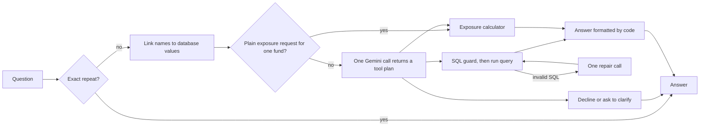

# Portfolio Analytics Agent

Ask questions about portfolio data in plain English. The agent writes and safely runs SQL, calculates sector exposures, or combines the two, and it is built to answer quickly without letting a language model state a number.

```text
> Calculate the sector exposure breakdown for international equity
Sector exposure: International Equity Fund
sector            exposure_pct  portfolio_weight_pct  market_value_pct  holdings
Energy            38%           38%                   30.68%            2
Technology        36%           36%                   47.20%            4
Automotive        15%           15%                   13.53%            1
Consumer Staples  11%           11%                   8.60%             1
Note: Recorded weights and market values disagree by up to 11.2 points; the recorded weights may be stale.
```

The original brief is in [docs/ASSIGNMENT.md](docs/ASSIGNMENT.md). Design decisions and trade-offs are in [docs/DESIGN.md](docs/DESIGN.md).

## Run it

Requires Python 3.12 or newer and a [Gemini API key](https://aistudio.google.com/apikey).

```bash
python -m venv .venv
source .venv/bin/activate          # Windows: .venv\Scripts\activate
pip install -r requirements-dev.txt
cp .env.example .env               # then set GEMINI_API_KEY
```

| Task | Command |
| --- | --- |
| Ask one question | `python -m portfolio_agent "How many portfolios do we have in total?"` |
| Interactive prompt | `python -m portfolio_agent` |
| See SQL, route and timings | add `--trace` |
| Evaluate on the ground truth | `python evaluate.py` |
| Add held-out, hybrid and safety cases | `python evaluate.py --extended` |
| Check everything except the model, no key needed | `python evaluate.py --self-test --extended` |
| Web UI and REST API | `uvicorn portfolio_agent.api:app`, then open http://127.0.0.1:8000 |
| Unit tests | `pytest` |
| Audit the dataset | `python -m portfolio_agent --check-data` |

The database is built from the CSVs on first run.

## How it works



Latency comes from what the system avoids:

- **One model call per question.** Gemini returns the whole plan at once, including both steps of a hybrid question. A second call happens only to repair invalid SQL.
- **No model call to write the answer.** Code formats the database's values, which also means the model cannot misquote or invent a figure.
- **No model call when none is needed.** A plain exposure request for one named fund goes straight to the calculator.
- **Low-effort model settings.** Minimal thinking, a warmed connection and a prompt with no result data in it.
- **Hedged requests.** If a model has not answered in 2.5 s, or fails, the next one starts and the first answer wins. Shared-tier latency swings between about 1 s and over 10 s for identical requests, so this matters more than the choice of model.

## Results

### Live model accuracy and latency

> **Final run pending.** The free tier allows 20 requests per model per day, so the evaluation spans several sessions: `python evaluate.py --extended --delay 4 --resume` keeps scored results and reruns the rest, writing `reports/live_full_extended.md`.

### Measured without the model

| Measure | Result |
| --- | --- |
| Unit and integration tests | 106 passed |
| Scorer self-test, 40 cases with reference plans replayed | 40 of 40 |
| Sector exposure fast path, uncached, 300 runs | p50 2.7 ms, p95 4.3 ms |
| Exact-repeat cache hit, 300 runs | p50 0.015 ms |

The self-test proves the tools, guard and scorer work together. It says nothing about the model's accuracy, which is why it is reported separately. Timings were taken in process on a Windows laptop and exclude network time.

## How accuracy is evaluated

The ground truth gives reference SQL rather than answers, so the evaluator computes the expected results and compares data, not query text.

- **Grades:** `exact`, `equivalent` (extra columns, or extra rows showing zero), `partial` (right rows, missing columns), `fail`. Strict accuracy counts only the first two; partial answers appear in a separate lenient figure.
- **Independent exposure check:** expected exposures are calculated from the raw CSVs by separate code. A test confirms both implementations agree on all 13 portfolios.
- **The scorer is itself tested:** mutated answers (swapped rows, wrong filter, altered exposure) must fail.
- **No leakage:** a test fails if any evaluation question or query appears in a prompt.
- **Beyond the brief's 10 questions:** 30 more cover paraphrases, time series, bond-only funds, typos, hybrid questions, attacks, unanswerable questions and ambiguity.
- **Query cost:** SQLite VM steps stand in for logical I/O, compared with the reference query to give a performance-adjusted score. Full table scans are recorded.
- **Stability:** `--runs 3` repeats every case, because a correct answer that appears only sometimes is not reliable. Caching is always off during evaluation.
- **Outages are separate:** a model that cannot be reached is reported as an infrastructure error, not a wrong answer.

## What the data revealed

Run `python -m portfolio_agent --check-data` to reproduce the computed findings.

| Finding | What the agent does |
| --- | --- |
| Total Stock Market Index Fund weights sum to 98%, not 100% | Normalises over equities and shows a warning |
| Fixed Income Plus and Total Bond Market hold no equities | Says there is no exposure, rather than dividing by zero |
| `current_weight` disagrees with quantity x price, by 11 points for International Equity | Reports both, and warns that weights may be stale |
| `total_aum` is 7x to 59x the value of listed holdings | Defines "value" as quantity x price and never mixes the two |
| Performance and risk data cover only 4 of 13 portfolios | Returns only what exists |
| Home Depot is classified as Consumer Staples (usually Consumer Discretionary) | Uses the data as given; noted for data owners |

Exposure is ambiguous for mixed funds, so the tool returns both definitions: share of the equity holdings (sums to 100%, the headline figure, as the brief says to consider only equities) and share of the whole portfolio.

**Issues in the ground truth:** Q7 says "for each portfolio" but its reference query omits the five with no technology holdings. Listing them at zero is arguably more correct, so the scorer grades it `equivalent`. Q10's explanation mentions a portfolio ID while its parameters use a name. The brief's `gemini-pro` model and `google.generativeai` package are obsolete; this project uses `google-genai`.

## Safety

Model-written SQL is treated as untrusted:

- The database file is opened read-only.
- An SQLite authorizer permits only `SELECT` on data tables and safe functions. It checks the compiled query, so text tricks do not get past it.
- One statement per query, with limits on time, work, rows and value size.
- Blocked queries are refused and never sent back for repair.
- Query results and stored free text never reach the model, so data cannot act as a prompt injection, and a failed query returns only the database's error message.
- The agent declines recommendations, forecasts and anything outside the data. It asks when a name could mean several funds.
- The public API has per-client rate limiting and security headers, and the UI inserts data as text only.

## REST API

```bash
curl -X POST http://127.0.0.1:8000/api/ask \
  -H "Content-Type: application/json" \
  -d '{"question":"What are the sector exposures for the Tech Innovation Fund?"}'
```

The response includes `status`, `answer`, `route`, `steps` (SQL, rows, exposures), `warnings`, `timings_ms` and `llm`. Also available: `GET /api/health`, `GET /api/metrics` (latency by route) and `GET /docs`.

## Deploy

The container serves the UI and API from one process and contains its own database.

**Hugging Face Spaces (recommended; free, 2 vCPU and 16 GB). A Space sleeps after a period without use, so open it once before sharing a link:**

```bash
pip install huggingface_hub
hf auth login
python scripts/deploy_hf_space.py your-username/portfolio-analytics-agent
```

**Render:** create a Blueprint from this repository (`render.yaml`) and set `GEMINI_API_KEY`. The free plan sleeps when idle, so the first request after a pause is slow.

**Any container host:** `docker build -t portfolio-agent . && docker run -p 7860:7860 -e GEMINI_API_KEY=... portfolio-agent`

## Project layout

```text
portfolio_agent/
  agent.py        routing and plan execution
  tools.py        exposure calculator and SQL tool
  sql_guard.py    safe execution of model-written SQL
  metadata.py     schema cards, glossary, entity linking, schema retrieval
  prompts.py      prompt assembly
  llm.py          Gemini client
  render.py       answer formatting, no model involved
  cache.py        exact-match cache
  db.py           database build and data audit
  evaluation.py   scoring
  api.py, static/ REST API and web UI
evaluate.py       evaluation command
eval/             held-out questions
scripts/          retrieval and model latency benchmarks, deployment
tests/            unit and integration tests
```
