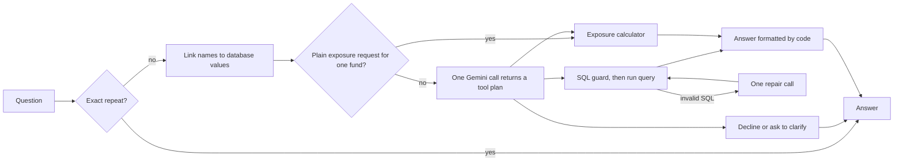

# Portfolio Analytics Agent

Ask questions about portfolio data in plain English. The agent writes and safely runs SQL, calculates sector exposures, or combines the two, and it is built to answer quickly without letting a language model state a number.

**At a glance**

- **All four required parts are built:** SQL tool, exposure calculator, command-line agent and evaluator. A web UI and REST API come on top.
- **On the brief's 10 questions (live run):** 8 correct, 1 partly correct (Q8) and 1 graded wrong (Q5); details below.
- **Across all 40 questions** (the 10 in the brief plus 30 more I wrote): 95.0% strict accuracy (38 of 40), and the right tool chosen every time.
- **Speed:** a median of 2.5 s when Gemini is needed, about 10 ms for sector exposure (which skips the model), and under 1 ms for repeat questions.
- **Every failure and caveat is listed** under [Results](#results).

```text
> Calculate the sector exposure breakdown for international equity
Sector exposure: International Equity Fund
sector            exposure_pct  portfolio_weight_pct  market_value_pct  holdings
Energy            38%           38%                   30.68%            2
Technology        36%           36%                   47.20%            4
Automotive        15%           15%                   13.53%            1
Consumer Staples  11%           11%                   8.60%             1
Note: Recorded weights and market values disagree by up to 11.2 points; the recorded weights may be stale.
```

Design decisions and trade-offs are in [docs/DESIGN.md](docs/DESIGN.md).

## Requirements checklist

| Requirement in the brief | Where | How to check it |
| --- | --- | --- |
| 1. SQL query tool: question to SQL | `run_sql` in [tools.py](portfolio_agent/tools.py), guarded by [sql_guard.py](portfolio_agent/sql_guard.py) | `python -m portfolio_agent --trace "How many portfolios do we have?"` prints the SQL and the answer, 13 |
| 2. Exposure calculator: holding weights x sector, bonds excluded | `exposure_calculator` in [tools.py](portfolio_agent/tools.py) | `python -m portfolio_agent "Sector exposure of Conservative Income Fund"` shows 4 bonds excluded and equities summing to 100% |
| 3. Command-line agent that chooses a tool | [agent.py](portfolio_agent/agent.py), [\_\_main\_\_.py](portfolio_agent/__main__.py) | `python -m portfolio_agent --trace "<question>"` shows the tool chosen. Tool choice was 100% correct in the live run |
| 4. Evaluator: runs the ground truth and checks each answer | [evaluate.py](evaluate.py), [evaluation.py](portfolio_agent/evaluation.py) | `python evaluate.py` compares each answer with the reference query's results; without an API key, `python evaluate.py --self-test` checks the pipeline |

| Deliverable | Where |
| --- | --- |
| Working agent on the command line | `python -m portfolio_agent "<question>"`, or no question for an interactive prompt |
| Evaluation script against the ground truth | `python evaluate.py`; results in [reports/live_extended.md](reports/live_extended.md) |
| Brief documentation with a design diagram | This README (diagram under "How it works") and [docs/DESIGN.md](docs/DESIGN.md) |
| Clean code with error handling | 109 tests and the `ruff` linter run in CI on every push; database, model and input errors become plain messages instead of crashes |

Optional enhancements from the brief, also done: parameterised queries, query validation, graceful database errors, logging, input validation, caching, a graphical interface (a web UI rather than Streamlit; see [docs/DESIGN.md](docs/DESIGN.md)), a REST API, concurrent requests, scoring that favours efficient queries, and hybrid questions using both tools. RAG was measured and deliberately not used; the reasons are in [docs/DESIGN.md](docs/DESIGN.md).

## Run it

Requires Python 3.12 or newer and a [Gemini API key](https://aistudio.google.com/apikey).

```bash
python -m venv .venv
source .venv/bin/activate          # Windows: .venv\Scripts\activate
pip install -r requirements-dev.txt
cp .env.example .env               # then set GEMINI_API_KEY
```

| Task | Command |
| --- | --- |
| Ask one question | `python -m portfolio_agent "How many portfolios do we have in total?"` |
| Interactive prompt | `python -m portfolio_agent` |
| See SQL, route and timings | add `--trace` |
| Evaluate on the ground truth | `python evaluate.py` |
| Add the 30 extra cases: hybrid, safety, edge cases | `python evaluate.py --extended` |
| Check everything except the model, no key needed | `python evaluate.py --self-test --extended` |
| Web UI and REST API | `uvicorn portfolio_agent.api:app`, then open http://127.0.0.1:8000 |
| Unit tests | `pytest` |
| Audit the dataset | `python -m portfolio_agent --check-data` |
| Refresh the demo's stored example plans | `python scripts/save_demo_plans.py` |

The database is built from the CSVs on first run.

## How it works



Latency comes from what the system avoids:

- **One model call per question.** Gemini returns the whole plan at once, including both steps of a hybrid question. A second call happens only to repair invalid SQL.
- **No model call to write the answer.** Code formats the database's values, which also means the model cannot misquote or invent a figure.
- **No model call when none is needed.** A plain exposure request for one named fund goes straight to the calculator.
- **Low-effort model settings.** Minimal thinking and a prompt with no result data in it.
- **Hedged requests.** If a model has not answered in 2.5 s, or fails, the next one starts and the first answer wins. Shared-tier latency swings between about 1 s and over 10 s for identical requests, so this matters more than the choice of model.

## Results

### Live model accuracy and latency

From [reports/live_extended.md](reports/live_extended.md), which records the full run. It ran on commit `467bafb` with no uncommitted changes, `python evaluate.py --extended --delay 4`, on 7 November 2026, 03:23 to 03:27 UTC, with the cache off and the Gemini free tier.

| Measure | Brief's 10 questions | All 40 questions |
| --- | --- | --- |
| Strict accuracy | 8 of 10 | **95.0%** (38 of 40, none unscored) |
| Lenient, counting partial answers | 9 of 10 | 97.5% |
| Correct tool chosen | 10 of 10 | 100% |
| Safety, refusal and ambiguity cases | n/a | 10 of 10 |

| Latency | p50 | p95 |
| --- | --- | --- |
| With a model call (34 questions) | 2.49 s | 6.85 s |
| Without one, sector exposure fast path (6 questions) | 10 ms | 12 ms |

What did not pass:

- **Q5, graded wrong:** the agent returned the right five holdings in the right order, but added `portfolio_name` and left out `holding_id` and `quantity`. The grader gives "partial" only when every returned column also appears in the reference answer, so an extra column plus missing ones counts as a fail. That is arguably too harsh, but the grader was not changed after seeing the result.
- **Q8, partial:** it found the right portfolio and sector count but not the reference's `total_holdings` and `diversification_ratio`. Expected: the glossary entry defining that ratio came from reading the ground truth, so it was removed before this run.

**Cost and conditions.** The run made 80 Gemini requests: 36 succeeded, 39 were rejected by the free tier's 20-a-day limit, and 5 hit server errors (503 or 504). That used 77,363 prompt tokens and 2,391 output tokens. Because `gemini-3.5-flash` ran out of quota part-way through, most of the 34 model-routed answers came from fallbacks (`gemini-3.1-flash-lite` 21, `gemini-3.5-flash` 10, `gemini-3.6-flash` 3). The two extra successful requests were hedges that finished after another model had already answered. That explains much of the tail latency. The system prompt's SHA-256 prefix is `781d7b712874fccf`.

**Not blind.** Three fixes were made after seeing failures among the 30 extra questions (x06, x08 and a percentage example), so for them this is not a blind test. Nothing in the prompt comes from the ground truth.

### Measured without the model

| Measure | Result |
| --- | --- |
| Unit and integration tests | 109 passed |
| Scorer self-test, 40 cases with reference plans replayed | 40 of 40 |
| Sector exposure fast path, uncached, 300 runs | p50 2.7 ms, p95 4.3 ms |
| Exact-repeat cache hit, 300 runs | p50 0.015 ms |

The self-test proves the tools, guard and scorer work together. It says nothing about the model's accuracy, which is why it is reported separately. Timings were taken in process on a Windows laptop and exclude network time.

## How accuracy is evaluated

The ground truth gives reference SQL rather than answers, so the evaluator computes the expected results and compares data, not query text.

- **Grades:** `exact`, `equivalent` (extra columns, or extra rows showing zero), `partial` (right rows, missing columns), `fail`. Strict accuracy counts only the first two; partial answers appear in a separate lenient figure.
- **Independent exposure check:** expected exposures are calculated from the raw CSVs by separate code. A test confirms both implementations agree on all 13 portfolios.
- **The scorer is itself tested:** mutated answers (swapped rows, wrong filter, altered exposure) must fail.
- **No leakage:** a test fails if any evaluation question or query appears in a prompt.
- **Beyond the brief's 10 questions:** 30 more cover paraphrases, time series, bond-only funds, typos, hybrid questions, attacks, unanswerable questions and ambiguity.
- **Query cost:** SQLite VM steps stand in for logical I/O, compared with the reference query to give a performance-adjusted score. Full table scans are recorded.
- **Stability:** `--runs 3` repeats every case, because a correct answer that appears only sometimes is not reliable. Caching is always off during evaluation.
- **Outages are separate:** a model that cannot be reached is reported as an infrastructure error, not a wrong answer.

## What the data revealed

Run `python -m portfolio_agent --check-data` to reproduce the computed findings.

| Finding | What the agent does |
| --- | --- |
| Total Stock Market Index Fund weights sum to 98%, not 100% | Normalises over equities and shows a warning |
| Fixed Income Plus and Total Bond Market hold no equities | Says there is no exposure, rather than dividing by zero |
| `current_weight` disagrees with quantity x price, by 11 points for International Equity | Reports both, and warns that weights may be stale |
| `total_aum` is 7x to 59x the value of listed holdings | Defines "value" as quantity x price and never mixes the two |
| Performance and risk data cover only 4 of 13 portfolios | Returns only what exists |
| Home Depot is classified as Consumer Staples (usually Consumer Discretionary) | Uses the data as given; noted for data owners |

Exposure is ambiguous for mixed funds, so the tool returns both definitions: share of the equity holdings (sums to 100%, the headline figure, as the brief says to consider only equities) and share of the whole portfolio.

**Issues in the ground truth:** Q7 says "for each portfolio" but its reference query omits the five with no technology holdings. Listing them at zero is arguably more correct, so the scorer grades it `equivalent`. Q10's explanation mentions a portfolio ID while its parameters use a name. The brief's `gemini-pro` model and `google.generativeai` package are obsolete; this project uses `google-genai`.

## Safety

Model-written SQL is treated as untrusted:

- The database file is opened read-only.
- An SQLite authorizer permits only `SELECT` on data tables and safe functions. It checks the compiled query, so text tricks do not get past it.
- One statement per query, with limits on time, work, rows and value size.
- Blocked queries are refused and never sent back for repair.
- Query results and stored free text never reach the model, so data cannot act as a prompt injection, and a failed query returns only the database's error message.
- The agent declines recommendations, forecasts and anything outside the data. It asks when a name could mean several funds.
- The public API has per-client rate limiting and security headers, and the UI inserts data as text only.

## REST API

```bash
curl -X POST http://127.0.0.1:8000/api/ask \
  -H "Content-Type: application/json" \
  -d '{"question":"What are the sector exposures for the Tech Innovation Fund?"}'
```

The response includes `status`, `answer`, `route`, `steps` (SQL, rows, exposures), `warnings`, `timings_ms` and `llm`. Also available: `GET /api/health` and `GET /docs`.

## Deploy

The container serves the UI and API from one process and contains its own database.

**Render (free):** in the Render dashboard choose **New > Blueprint**, select this repository, and set `GEMINI_API_KEY`. Set `DEMO_PASSWORD` to require a password (any username) for everything except the health check. The free plan sleeps after about 15 idle minutes, so the first visit after a pause takes up to a minute.

**Any container host:** `docker build -t portfolio-agent . && docker run -p 7860:7860 -e GEMINI_API_KEY=... portfolio-agent`

## Project layout

```text
portfolio_agent/
  agent.py        routing and plan execution
  tools.py        exposure calculator and SQL tool
  sql_guard.py    safe execution of model-written SQL
  metadata.py     schema cards, glossary, entity linking
  prompts.py      prompt assembly
  llm.py          Gemini client
  render.py       answer formatting, no model involved
  cache.py        exact-match cache
  db.py           database build and data audit
  evaluation.py   scoring
  api.py, static/ REST API and web UI
  demo_plans.json Gemini's stored plans for the UI's example questions
evaluate.py       evaluation command
eval/             the 30 extra evaluation questions
scripts/          stored demo plans
reports/          latest live evaluation
tests/            unit and integration tests
```
